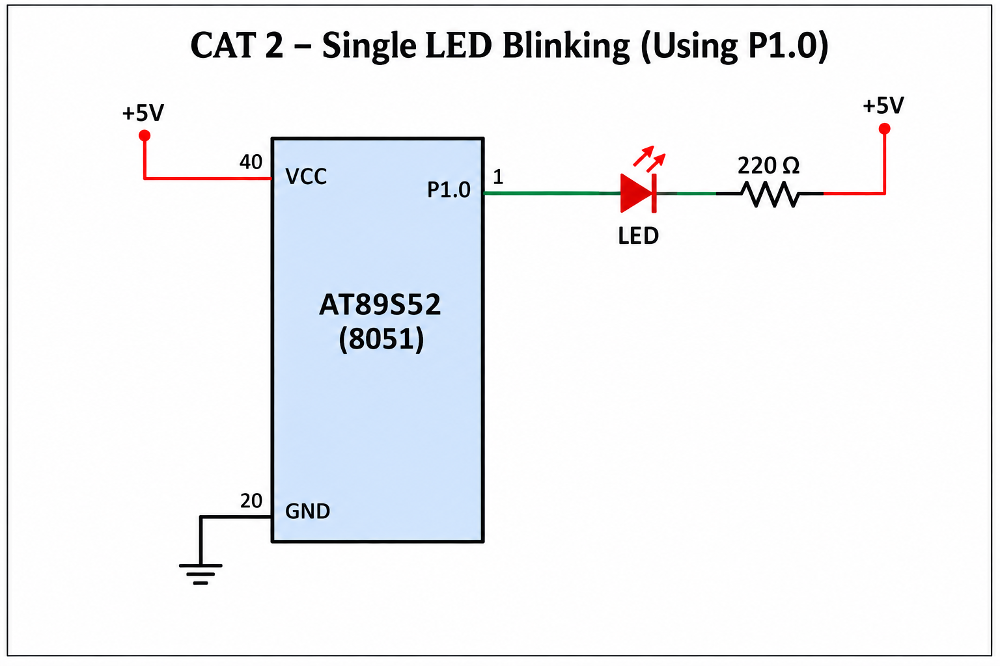

# EXPERIMENT DETAILS

**EXP:** CONTINUOUS ASSESSMENT 2  
**NAME OF EXP:** LED Blinking using 8051 Microcontroller  
**HARDWARE SETUP / PLATFORM:** 8051 Development Board, Keil µVision

---

## TASK 2A: SINGLE LED BLINKING

### 1. Circuit Diagram

**Components Required:**
- 8051 Microcontroller (AT89S52)
- 1 LED
- Current-limiting resistor (220Ω–330Ω)
- 5V power supply

**Connections:**

- LED anode (+) → +5V through a current-limiting resistor.
- LED cathode (-) → P1.0 of the 8051.



### 2. Core Logic / Pseudocode / Code Base

**Working Principle:**

The program configures pin P1.0 as the output for controlling a single LED. Since the LED is connected in an active-low configuration, setting P1.0 to LOW turns the LED ON, while setting it HIGH turns the LED OFF.

A delay function is used to create a visible blinking effect. This process repeats continuously inside an infinite loop.

**Pseudocode:**

1. Start the program.
2. Set P1.0 to LOW to turn ON the LED.
3. Call the delay function.
4. Set P1.0 to HIGH to turn OFF the LED.
5. Call the delay function.
6. Repeat steps 2–5 continuously.

**Code Base:**

```c
#include <REG51.H>

sbit LED = P1^0;

void delay()
{
    int i, j;
    for(i = 0; i < 500; i++)
        for(j = 0; j < 100; j++);
}

void main()
{
    while(1)
    {
        LED = 0;   // LED ON
        delay();

        LED = 1;   // LED OFF
        delay();
    }
}
```

### 3. Inference

The experiment demonstrates basic GPIO output control using the 8051 microcontroller. The LED connected to P1.0 blinks continuously with a delay between ON and OFF states.

