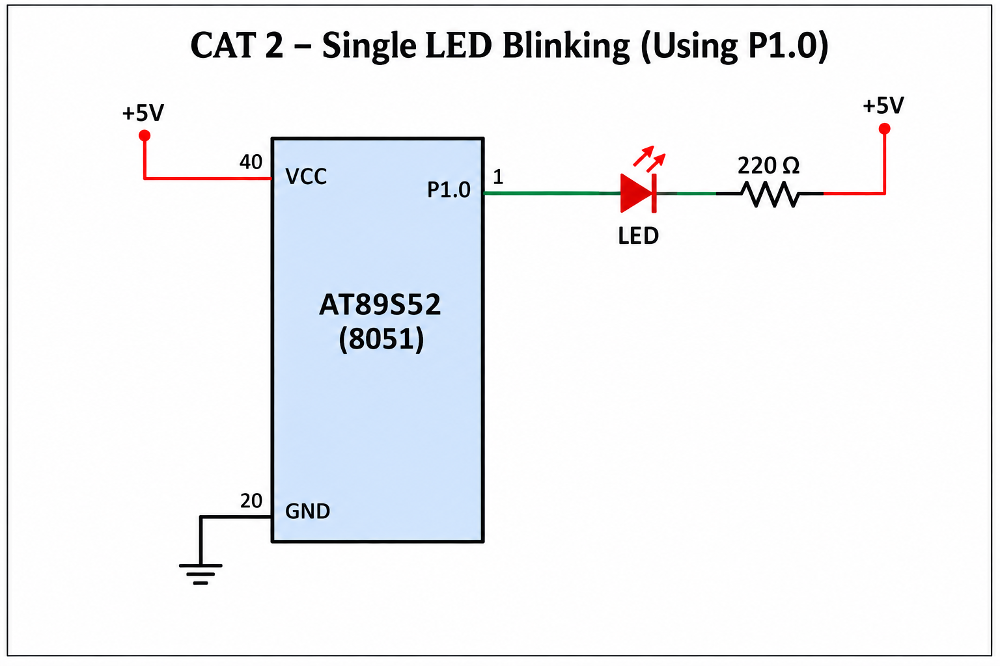

# TASK1 – Four LED, Four Mode Controller

## Objective
Implement a register-level GPIO controller using bare-metal C: four LEDs as outputs and one push-button as input. Each debounced button press advances the mode exactly once.

## Modes
1. Running LED: LED1 → LED2 → LED3 → LED4 → repeat.
2. Binary counter: 0000 → 0001 → … → 1111 → 0000.
3. Alternating pattern: 1010 ↔ 0101.
4. All LED flash: 1111 ↔ 0000.

The initial state is all LEDs OFF. The first valid button press enters Mode 1.

## Board assumptions — MUST verify
| Signal | Assumed MCU pin | Note |
|---|---|---|
| LED1 | P1.0 | active-low |
| LED2 | P1.1 | active-low |
| LED3 | P1.2 | active-low |
| LED4 | P1.3 | active-low |
| Button | P3.2 / INT0 | active-low; external pull-up |
| Clock | Board crystal | frequency not supplied |

These pin assignments are placeholders, not confirmed wiring. Change the `sbit`/mask and LED polarity if the actual board differs.

## Files
- `main.c` – GPIO setup, four modes, software debounce and release wait.

## Circuit diagram

This is an illustrative circuit using assumed pins: P1.0–P1.3 for LEDs and P3.2 for the button. Confirm actual development-board wiring, LED polarity/resistors, button pull-up, crystal, reset, VCC/GND and EA connection before implementation.

## Build / test checklist
- [ ] Confirm LED pins and active polarity from board schematic.
- [ ] Confirm button pin and electrical pull-up/pull-down.
- [ ] Confirm oscillator frequency and calibrate software delays.
- [ ] Build with Keil C51-compatible compiler.
- [ ] Test one button press = one mode transition.
- [ ] Verify all four modes and initial all-OFF state.

## Timing caveat
`delay_ms()` is a rough busy-wait. Its duration depends on crystal frequency and compiler optimization; calibrate on hardware. During the delays the main loop does not scan the button, so very short presses may be missed. For a strict responsive implementation, use a timer-based periodic scan and debounce state machine.

## Circuit

