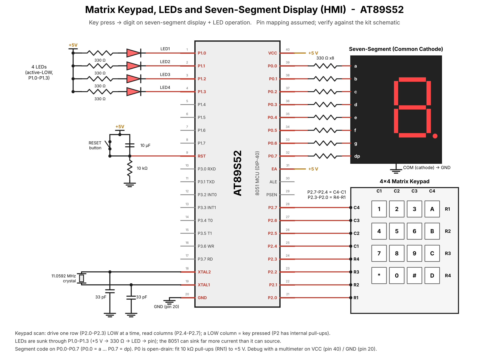

# TASK2 – Human-Machine Interface using Matrix Keypad, LEDs, and Seven-Segment Display

## Objective
Read a numeric key from a matrix keypad, display the key on a seven-segment display, and execute its associated LED operation.

## Key map / expected behavior
| Key | Seven-segment | LED behavior |
|---:|---:|---|
| 1 | 1 | LED1 ON |
| 2 | 2 | LED2 ON |
| 3 | 3 | LED3 ON |
| 4 | 4 | LED4 ON |
| 5 | 5 | Running LED pattern |
| 6 | 6 | Alternating LEDs (1010 ↔ 0101) |
| 7 | 7 | Binary counter (0–15) |
| 8 | 8 | All LEDs blink |
| 9 | 9 | All LEDs OFF |
| 0 | 0 | Reset system/display |

## Function requirements
The task asks for separate functions: `keypad_scan()`, `display_digit(unsigned char value)`, `led_control(unsigned char key)`, `running_led()`, `binary_counter()`, `alternate_led()`, and `blink_all()`. They are implemented in `main.c` for this starter.

## Pin assumptions — verify against your kit
| Component | Assumed connection |
|---|---|
| Keypad rows | P2.0–P2.3 |
| Keypad columns | P2.4–P2.7 |
| LEDs | P1.0–P1.3, active-low |
| Seven segment | P0.0–P0.7 = a,b,c,d,e,f,g,dp |
| Display type | Single-digit common cathode |
| MCU | AT89S52 |

**These are example assignments, not confirmed board wiring.** Common-anode displays require inverted segment patterns. P0 needs external pull-ups. If the keypad layout differs, edit `keymap`.

## Circuit diagram

This is a simplified wiring diagram. Confirm actual pin mappings, display type, current-limiting resistors, digit common, and board connections before use.

## Build and test
1. Compile with Keil C51 and the appropriate `REGX52.H`.
2. Verify the keypad row/column order and segment wiring.
3. Test keys 1–4 individually, then modes 5–8, OFF (9), and reset (0).
4. Confirm display and LED operation for each key.

## Limitations
The activity functions are blocking; keypad scanning pauses while an LED pattern runs. The delay is approximate and depends on clock/compiler. A non-blocking timer-based design is preferable if the assessment expects keypad responsiveness during patterns.

## Circuit

