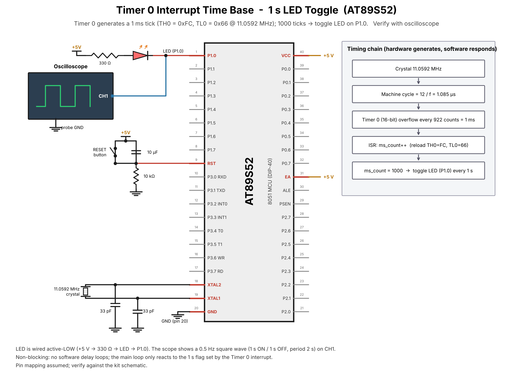

# TASK1 – Hardware Timer and Interrupt-Based Time Base

## Objective
Configure Timer0 in 16-bit mode to generate approximately 1 ms interrupts and build a 1-second software time base without software delay loops.

## Files
- `main.c` – Timer0 setup, ISR reload, millisecond tick, 1-second LED toggle.

## Timer calculation (11.0592 MHz, classic 12T 8051)
- Machine-cycle time = 12 / 11.0592 MHz ≈ 1.085 µs.
- Counts for 1 ms ≈ 922.
- Reload = 65536 − 922 = 64614 = `FC66H` (approximate).
- ISR reloads TH0/TL0 and increments a software tick counter.

## Circuit diagram

LED assumed on P1.0 active-low. Include/verify the board crystal and reset circuit; the timer itself needs no external timer component.

## Verification
Use an oscilloscope/logic analyzer or observe LED toggling. Timer interrupt accuracy depends on actual crystal and interrupt latency.

## Circuit

