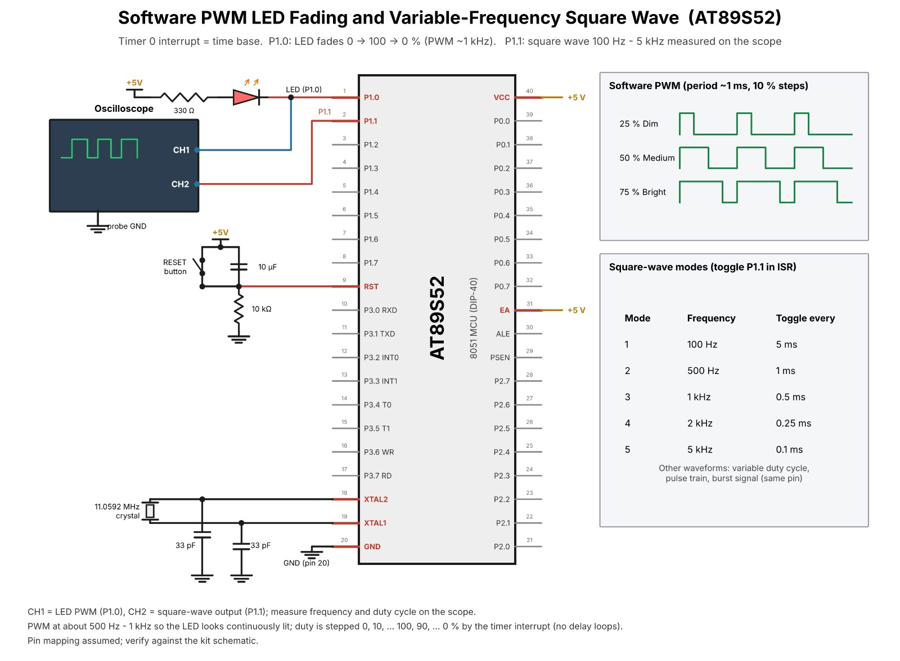

# TASK2 – Software PWM LED Fading and Variable-Frequency Wave

## Objective
Use timer interrupts (not delay loops) to fade an LED with software PWM and generate a selectable square-wave output.

## Files
- `main.c` – interrupt-driven PWM/fade and square-wave output example.

## Pin assumptions
- PWM LED: P1.0, active-low.
- Square wave: P1.1; connect to oscilloscope/logic analyzer.
- 11.0592 MHz crystal; Timer0 reload FC66H (~1 ms).

## Timing caveat (important)
A 1-ms interrupt gives 50-Hz PWM with 20 phase slots (~5% duty steps), which may flicker. The handout recommends 500 Hz–1 kHz PWM; that requires a faster interrupt (e.g. 50–100 µs) and/or fewer duty steps. Also, 1-ms interrupt granularity cannot produce 100 Hz–5 kHz square waves as listed: use a faster timer tick or hardware timer toggle. This code is a starter framework, not a frequency-accurate final implementation for all listed modes. Update timer reload and tick scheduling based on your lab's target frequencies.

## Circuit diagram

