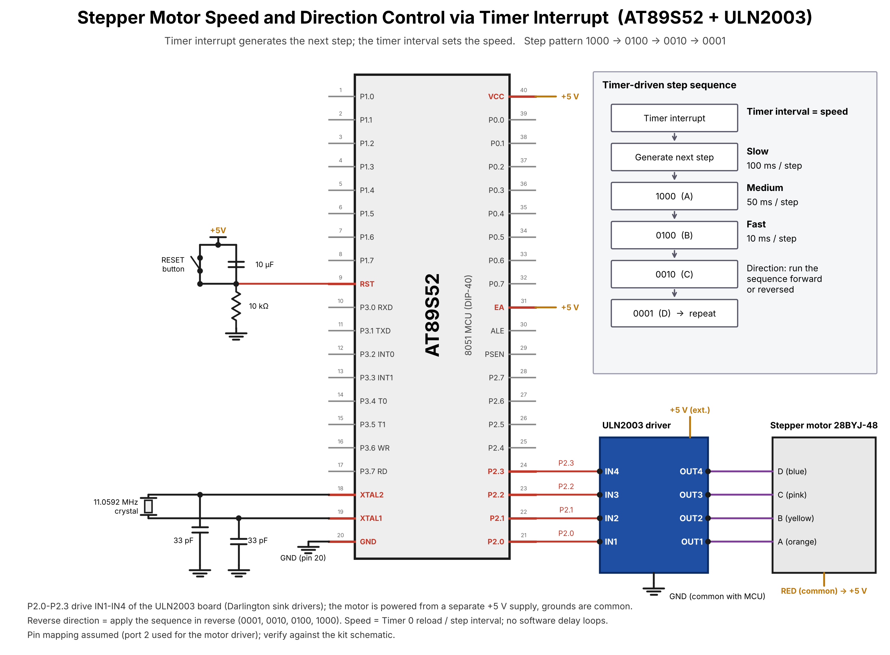

# TASK3 – Stepper Motor Speed and Direction Control (Optional)

## Objective
Use a timer interrupt as a non-blocking time base to advance a stepper motor sequence. Timer interval controls speed; sequence order controls direction.

## Files
- `main.c` – timer-driven step event and example 4-step output sequence.

## Circuit diagram

## Important safety/hardware note
Never drive a stepper motor directly from AT89S52 GPIO. Use a suitable driver (e.g., ULN2003 for a unipolar motor or a suitable H-bridge/driver), external motor supply, and common ground. The exact motor/driver and pinout must be confirmed before wiring.

## Example speed intervals
- Slow: 100 ms/step
- Medium: 50 ms/step
- Fast: 10 ms/step

Change `step_interval` accordingly. Reverse direction by reversing the sequence order.

## Verify
Confirm motor type, driver board, phase wiring, and step sequence from your lab kit. This sample sequence may need adjustment.

## Circuit

