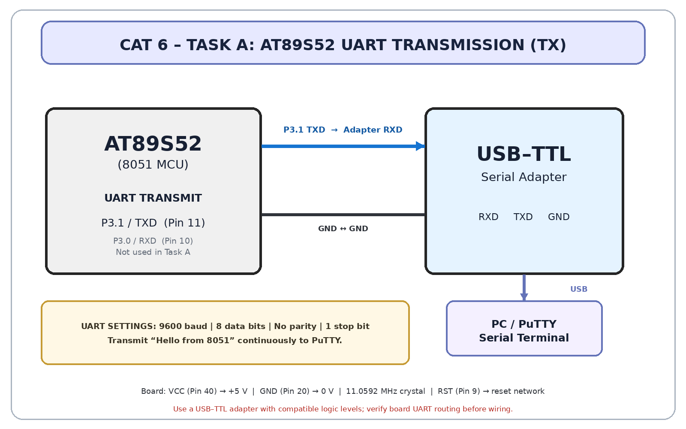

# CAT5 – TASK A: UART Initialization and Character Transmission

## Objective
Configure the AT89S52 UART for 9600-8-N-1 and continuously transmit `Hello from 8051` to a PC terminal such as PuTTY.

## UART configuration
- UART mode 1: 8-bit asynchronous UART, variable baud rate.
- `SCON = 50H`: mode 1 and receiver enabled.
- Timer1 mode 2 (8-bit auto-reload): `TMOD` upper nibble = `20H`.
- `PCON.SMOD = 0`.
- At 11.0592 MHz: `TH1 = TL1 = FDH` gives 9600 baud.
- `SBUF` is the transmit data register; `TI` indicates transmit completion.
- Pins: TXD=P3.1 (physical pin 11); RXD=P3.0 (physical pin 10).

## Circuit diagram

## PuTTY setup
1. Connect USB-TTL adapter TXD to MCU RXD, adapter RXD to MCU TXD, and GND to GND.
2. Select the adapter's COM port in PuTTY (Serial).
3. Set 9600 baud, 8 data bits, 1 stop bit, no parity, no flow control.
4. Program the MCU and open the terminal.

**Use a TTL UART adapter, not a true RS-232 port.** Verify voltage compatibility and board pin labels.

## Circuit

