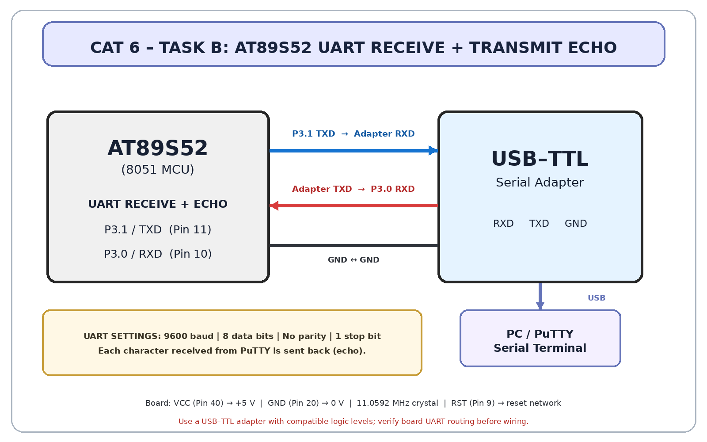

# CAT5 – TASK B: Interrupt-Driven UART Echo

## Objective
Receive characters from PuTTY using the UART interrupt, store them in an RX ring buffer, and echo each character back to the PC.

## Driver design
- Serial interrupt vector: `interrupt 4`.
- `RI` indicates a received character; read `SBUF` after clearing `RI`.
- RX ISR adds bytes to a circular buffer (`rx_buf`, `rx_head`, `rx_tail`).
- Foreground retrieves buffered characters and transmits them.
- `TI` is cleared in the ISR; TX routine waits for it before sending the next byte.
- Buffer overflow drops the newest byte and sets `rx_overflow`.

## Circuit diagram

## PuTTY configuration
9600 baud, 8 data bits, 1 stop bit, no parity, no flow control. Connect USB-TTL TXD→MCU RXD, USB-TTL RXD←MCU TXD, and common GND. Type `ABC123`; it should echo as `ABC123`.

**Hardware warning:** Use a TTL USB-to-serial adapter with matching logic voltage. Never connect RS-232 voltage levels directly to the MCU.

## Circuit

