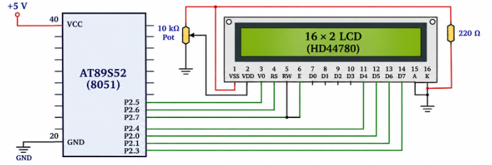

# EXPERIMENT DETAILS

**EXP:** CONTINUOUS ASSESSMENT 7  
**NAME OF EXP:** 16×2 LCD Driver Development and Dynamic Display Control  
**HARDWARE SETUP / PLATFORM:** 8051 Development Board (AT89S52), 16×2 HD44780 LCD, 4×4 Keypad, Keil µVision

---

# TASK 7A: LCD INITIALIZATION AND CHARACTER/STRING DISPLAY

## 1. Aim

To develop a 4-bit GPIO-based LCD driver for the AT89S52 microcontroller to initialize a 16×2 LCD, display individual characters and strings, and display text on both rows.

## 2. Circuit Diagram

## 3. Core Logic / Working Principle

A standard 16×2 HD44780-compatible LCD is interfaced with the 8051 microcontroller using a 4-bit parallel interface.

The LCD is initialized by sending a defined sequence of commands to configure:

- 4-bit interface mode.
- 2-line display.
- Display ON/OFF configuration.
- Cursor configuration.
- Entry mode.
- Display clearing and cursor positioning.

The following functions are implemented:

- `lcd_init()` – Initializes the LCD.
- `lcd_cmd()` – Sends commands to the LCD.
- `lcd_data()` – Sends character data to the LCD.

After initialization, individual characters and strings are displayed on both rows.

## 4. Pseudocode

1. Initialize the LCD in 4-bit, 2-line mode.
2. Configure the display settings.
3. Implement the LCD command function.
4. Implement the LCD data function.
5. Send characters or strings to the LCD.
6. Display text on the first and second rows.

## 5. Inference

The experiment demonstrates LCD initialization and character/string display using a 4-bit GPIO-based interface with the 8051 microcontroller.

---

# 

