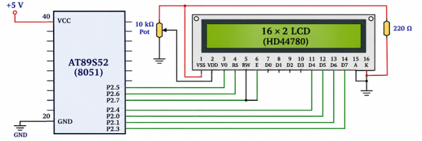

TASK 7B: CURSOR POSITIONING AND DYNAMIC VALUE UPDATE

## 1. Aim

To develop LCD cursor-positioning and data-update functions to display strings and dynamically updated numerical values at specified positions on a 16×2 LCD.

## 2. Circuit Diagram

The same 16×2 LCD interface used in Task 7A is used for this task.

## 3. Core Logic / Working Principle

This task extends the LCD driver developed in Task 7A by implementing functions for cursor positioning, string display, and numerical value display.

The following functions are implemented:

- `lcd_goto(row, column)` – Positions the LCD cursor at the specified row and column.
- `lcd_puts(string)` – Displays a string on the LCD.
- `lcd_print_number(value)` – Displays a numerical value on the LCD.

These functions allow text and numerical values to be displayed at specific positions and updated dynamically.

## 4. Pseudocode

1. Initialize the LCD.
2. Implement the cursor-positioning function.
3. Select the required row and column.
4. Implement the string-display function.
5. Implement the numerical-display function.
6. Display and update values at the required LCD positions.

## 5. Inference

The experiment demonstrates cursor positioning and dynamic display updates on a 16×2 LCD using the 8051 microcontroller.

---