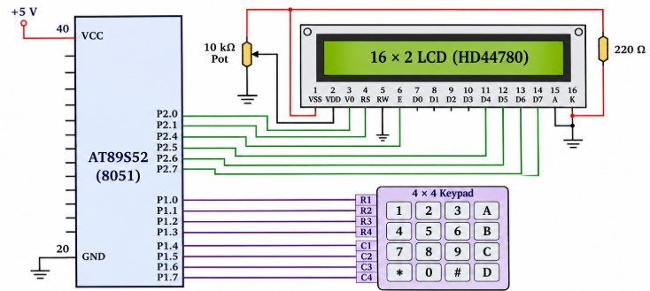

# TASK 7C: 4×4 KEYPAD-BASED CHARACTER MOVEMENT

## 1. Aim

To develop an interactive LCD application in which a character moves across a 16×2 LCD using a 4×4 keypad.

## 2. Circuit Diagram

This task uses the LCD interface along with a 4×4 matrix keypad.

## 3. Core Logic / Working Principle

A character is displayed on the 16×2 LCD and its position is controlled using four directional keys on the 4×4 keypad.

The keypad keys are assigned the following actions:

| Key | Action |
|---|---|
| 2 | Move Up |
| 8 | Move Down |
| 4 | Move Left |
| 6 | Move Right |

When a directional key is pressed, the character moves in the corresponding direction on the LCD display.

The LCD cursor-positioning function is used to update the character's location.

## 4. Pseudocode

1. Initialize the LCD in 4-bit mode.
2. Initialize and scan the 4×4 keypad.
3. Display a character at the initial LCD position.
4. Detect the pressed keypad key.
5. Check the key value:
   - If key 2 is pressed, move UP.
   - If key 8 is pressed, move DOWN.
   - If key 4 is pressed, move LEFT.
   - If key 6 is pressed, move RIGHT.
6. Update the character position on the LCD.
7. Repeat continuously.

## 5. Inference

The experiment demonstrates the interfacing of a 4×4 keypad with a 16×2 LCD. It provides interactive character movement using keypad input and demonstrates GPIO input handling and LCD cursor control.

---

# OVERALL INFERENCE

The experiment demonstrates 16×2 LCD interfacing with the AT89S52 microcontroller using a 4-bit GPIO-based driver. It covers LCD initialization, character and string display, cursor positioning, dynamic numerical updates, and interactive character movement using a 4×4 keypad.
