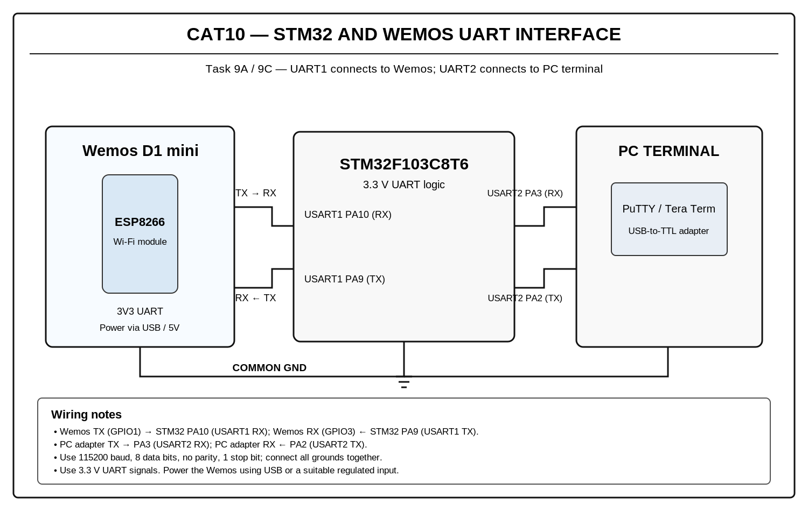

# TASK 10A – STM32 and Wemos UART Communication

## 1. Aim

To establish UART communication between the STM32F103C8T6 microcontroller and the Wemos D1 Mini (ESP8266) and verify data transmission using AT commands through a PC serial terminal.

## 2. Hardware Components

- STM32F103C8T6 (Blue Pill)
- Wemos D1 Mini (ESP8266)
- USB-to-TTL Serial Adapter
- Jumper Wires

## 3. Software Requirements

- STM32CubeMX
- Keil MDK
- PuTTY / Tera Term (Serial Terminal)
- ESP8266 AT Firmware

## 4. Circuit Connections

The STM32 uses two UART peripherals:

| STM32 Pin | Connection |
|---|---|
| PA9 (USART1 TX) | Wemos RX |
| PA10 (USART1 RX) | Wemos TX |
| PA2 (USART2 TX) | USB-to-TTL RX |
| PA3 (USART2 RX) | USB-to-TTL TX |
| GND | Common Ground |

**Communication Configuration:**
- Baud Rate: 115200
- Data Bits: 8
- Parity: None
- Stop Bits: 1

## Circuit diagram

## 5. Working Principle

1. Initialize the STM32 system clock and GPIO peripherals.
2. Configure USART1 for communication between the STM32 and Wemos D1 Mini.
3. Configure USART2 for communication between the STM32 and PC serial terminal.
4. Transmit the `AT` command to the ESP8266 through USART1.
5. Receive the ESP8266 response and forward it to the PC terminal through USART2.
6. Establish a transparent two-way UART bridge, allowing AT commands to be entered directly through the PC terminal and forwarded to the ESP8266.

The program also includes a Wi-Fi connection routine that configures the ESP8266 in station mode, connects it to a Wi-Fi network and retrieves its assigned IP address.

## 6. Expected Output

- Successful transmission of the `AT` command to the ESP8266.
- Reception of the ESP8266 response (`OK`) on the PC serial terminal.
- Two-way communication between the PC terminal and Wemos through the STM32.
- Ability to execute additional ESP8266 AT commands through the serial terminal.

## 7. Result

UART communication between the STM32F103C8T6 and Wemos D1 Mini is implemented using USART1, while USART2 provides communication with the PC terminal. The ESP8266 response can be monitored through the serial terminal.
