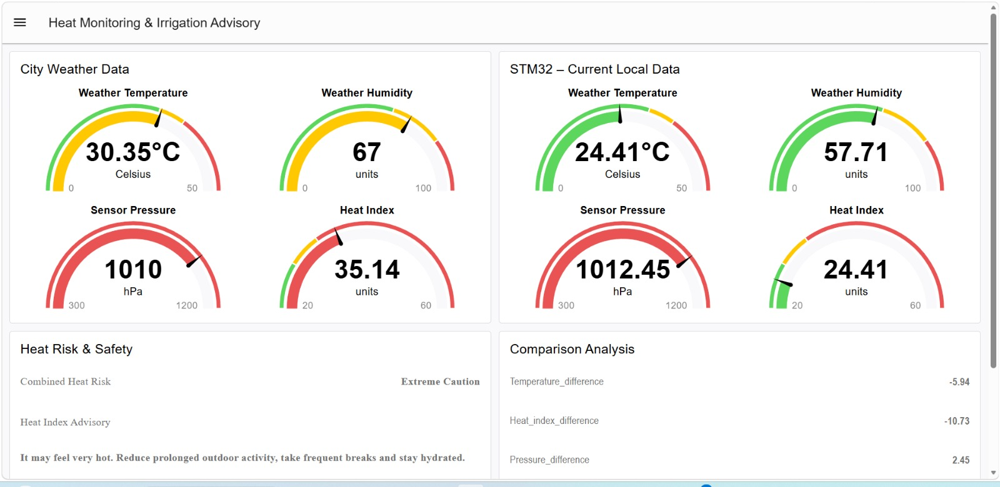
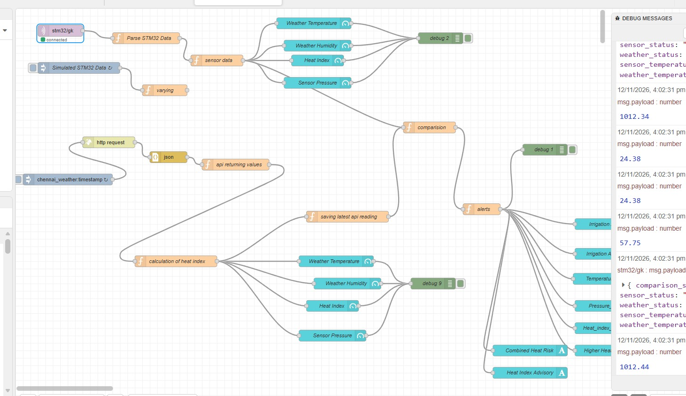

# CAT15 – Heat Monitoring and Irrigation Advisory using BME280, Wi-Fi, MQTT and Node-RED

## 1. Project Overview

CAT15 is an IoT-based environmental monitoring and advisory project built using an STM32F410RB, BME280 sensor, Wemos ESP8266 Wi-Fi module, MQTT and Node-RED.

The STM32 acquires local temperature, relative humidity and atmospheric pressure from the BME280 sensor. It sends the readings through the ESP8266 over Wi-Fi and publishes them to an MQTT broker. Node-RED receives the sensor data and combines it with city weather API data to calculate heat-index information, compare environmental readings, and display heat-safety and irrigation advisories.

The project keeps **Heat Index Risk** and **Irrigation Advisory** as two separate decision systems. A high heat-index category does not automatically mean a high irrigation alert.

## 2. Hardware and Software

### Hardware

- STM32 NUCLEO-F410RB (STM32F410RB)
- BME280 environmental sensor
- Wemos ESP8266 Wi-Fi module
- I2C and UART connections
- USB cable and suitable 3.3 V supply

### Software and tools

- STM32CubeMX
- Keil MDK
- STM32 HAL
- Bosch BME280 Sensor API
- ESP8266 support library
- MQTT
- Node-RED
- FlowFuse Dashboard
- City weather API

## 3. System Architecture

```text
BME280 Sensor
   | I2C1
   v
STM32F410RB
   | USART1 / UART
   v
ESP8266 Wi-Fi Module
   | Wi-Fi / TCP
   v
MQTT Broker
   | MQTT subscription
   v
Node-RED <--------- City Weather API
   |
   +--> Sensor and weather data processing
   +--> Heat-index calculation
   +--> Temperature / humidity / pressure comparison
   +--> Combined heat-risk classification
   +--> Irrigation advisory classification
   |
   v
Heat Monitoring & Irrigation Advisory Dashboard
```

## 4. STM32 BME280 Acquisition and MQTT Publishing

The supplied STM32 firmware performs the following operations:

1. Initializes the I2C1 peripheral.
2. Initializes the Bosch BME280 driver and loads sensor calibration data.
3. Configures temperature, pressure and humidity oversampling.
4. Sets the BME280 to normal measurement mode.
5. Acquires compensated sensor measurements periodically (the supplied code uses a 1-second interval).
6. Converts pressure from Pa to hPa.
7. Constructs a JSON payload.
8. Initializes the ESP8266 in station mode and connects it to the configured Wi-Fi network.
9. Opens a TCP connection to the MQTT broker.
10. Connects to the MQTT broker and publishes the sensor payload.

### MQTT configuration in the supplied firmware

| Setting | Value |
|---|---|
| Broker host | `broker.emqx.io` |
| Broker port | `1883` |
| MQTT client ID | `STM32_Publisher` |
| Publish topic | `farm/field01/telemetry` |
| QoS | 0 |
| Publish interval | 1 second |

### Published JSON payload

The firmware publishes the following fields:

```json
{
  "temperature_c": 28.45,
  "humidity_pct": 62.30,
  "pressure_hpa": 1008.72
}
```

The values above are examples only. Actual values depend on the BME280 readings and environment.

## 5. Node-RED Data Processing

The Node-RED flow shown in the project uses the following data sources:

- **STM32/MQTT sensor data:** local BME280 temperature, humidity and pressure.
- **City weather API:** external weather temperature and humidity, with pressure where available in the API response.

The flow processes the incoming data, calculates heat-index information, compares the local sensor readings with city weather readings, and prepares dashboard outputs.

The dashboard includes:

- City Weather Data
- STM32 – Current Local Data
- Weather temperature
- Weather humidity
- Sensor pressure
- Heat Index
- Heat Risk & Safety
- Combined Heat Risk
- Heat Index Advisory
- Comparison Analysis
- Irrigation alert and advisory outputs

The dashboard page is titled **Heat Monitoring and Irrigation Advisory** and uses the `/dashboard/heat-monitoring` path in the supplied dashboard configuration.

## 6. Heat Index Classification – NOAA/National Weather Service Categories

The Heat Index combines air temperature and relative humidity to estimate how hot conditions feel to people. The project classifies the calculated Heat Index using Fahrenheit thresholds.

| Heat Index (°C) | Heat Index (°F) | Classification |
|---|---:|---|
| Below 26.7°C | Below 80°F | Normal |
| 26.7–32.2°C | 80–90°F | Caution |
| 32.2–39.4°C | 90–103°F | Extreme Caution |
| 39.4–51.7°C | 103–125°F | Danger |
| 51.7°C and above | 125°F and above | Extreme Danger |

### Code decision order

```javascript
// HEAT INDEX: NOAA/NWS thresholds (Fahrenheit)

if (hiF < 80) {
    combinedRisk = "Normal";
} else if (hiF < 90) {
    combinedRisk = "Caution";
} else if (hiF < 103) {
    combinedRisk = "Extreme Caution";
} else if (hiF < 125) {
    combinedRisk = "Danger";
} else {
    combinedRisk = "Extreme Danger";
}
```

### Meaning of the classifications

- **Normal:** No elevated heat-index category.
- **Caution:** Fatigue may occur with prolonged exposure.
- **Extreme Caution:** Heat-related illness becomes more possible.
- **Danger:** Serious heat-related illness is possible.
- **Extreme Danger:** Very high risk of heat-related illness.

**Important interpretation:** NOAA/NWS Heat Index is intended primarily for human heat exposure under shaded, light-wind conditions. It is not a crop-stress classification and should not be treated as a rice irrigation threshold.

## 7. Irrigation Advisory – Project-Level Temperature and Humidity Rules

The irrigation advisory uses separate project-defined temperature and relative-humidity thresholds to identify possible atmospheric drying conditions. These are proposed project rules, not official rice irrigation standards.

| Condition | Temperature / Humidity rule | Alert |
|---|---|---|
| High | Temperature ≥ 35°C **AND** humidity ≤ 50% | HIGH |
| Moderate | Temperature ≥ 33°C **AND** humidity ≤ 60% | MODERATE |
| Monitor | Temperature ≥ 35°C **OR** humidity ≤ 40% | MONITOR |
| Normal | All other combinations | NORMAL |

### Code decision order

The order is important. Check HIGH first, then MODERATE, then MONITOR, and finally NORMAL.

```javascript
// IRRIGATION: Project-level advisory thresholds

if (temperature >= 35 && humidity <= 50) {
    alertLevel = "HIGH";
} else if (temperature >= 33 && humidity <= 60) {
    alertLevel = "MODERATE";
} else if (temperature >= 35 || humidity <= 40) {
    alertLevel = "MONITOR";
} else {
    alertLevel = "NORMAL";
}
```

### Meaning of irrigation alerts

- **HIGH:** Hot and dry air. Check field water level and soil condition promptly.
- **MODERATE:** Conditions may increase atmospheric drying. Review the irrigation schedule.
- **MONITOR:** One environmental condition needs attention. Check the field.
- **NORMAL:** No elevated atmospheric drying signal from these thresholds. Continue routine monitoring.

These alerts are advisory signals only. They do not independently determine whether irrigation is required.

## 8. Why Heat Index and Irrigation Alerts Are Separate

The two classifications answer different questions:

- **Heat Index Risk:** How hot conditions may feel to people, based on temperature and relative humidity.
- **Irrigation Advisory:** Whether the project's temperature and humidity rules indicate possible atmospheric drying conditions.

Therefore, a Danger heat-index result does not automatically produce a HIGH irrigation alert. Both outputs are evaluated independently.

## 9. Example Using Project Readings

Consider the following example local sensor readings:

| Parameter | Example value |
|---|---:|
| Temperature | 35°C |
| Relative humidity | 68% |
| Pressure | 1005 hPa |
| Heat Index | 49°C |

The resulting classifications are:

| Output | Result | Reason |
|---|---|---|
| Heat Index Risk | Danger | 49°C is within the 39.4–51.7°C Danger range |
| Irrigation Alert | MONITOR | Temperature is ≥35°C, but humidity is above 50% and 60%; the HIGH and MODERATE conditions are false, while the MONITOR temperature condition is true |
| Pressure | Displayed measurement | Pressure is not used by either classification |

**Advisory:** Check field water level and soil condition before deciding to irrigate.

## 10. Role of Atmospheric Pressure

The BME280 also measures atmospheric pressure. The project displays pressure and can compare sensor pressure with weather API pressure when available.

- Pressure is not part of the NOAA Heat Index formula.
- Pressure alone cannot determine whether rice needs irrigation.
- Pressure is retained as an additional environmental measurement for monitoring and comparison.

For actual irrigation decisions, additional information such as soil moisture, crop growth stage, rainfall and field water level would be required.

## 11. Dashboard and Workflow Screenshots

The dashboard screenshot documents the **Heat Monitoring & Irrigation Advisory** interface, including city weather data, STM32 local readings, heat-risk advisory and comparison analysis.



The Node-RED flow screenshot documents the MQTT sensor input, STM32 data parsing, weather API request and processing, comparison logic, alert processing and dashboard outputs.



## 12. Project Folder Structure

```text
CAT15/
├── README.md
├── STM32/
│   ├── Core/
│   ├── Drivers/
│   ├── MDK-ARM/
│   └── bme.ioc
├── NodeRED/
│   ├── README.md
│   └── dashboard_ui_config_partial.json
└── Documentation/
    ├── dashboard.png
    └── nodered_flow.png
```

## 13. Build and Run

### STM32 firmware

1. Open the STM32 project in Keil MDK.
2. Confirm the target is STM32F410RB.
3. Verify the I2C1 and USART1 pin configuration in the project.
4. Configure your Wi-Fi SSID and password locally in `STM32/Core/Src/main.c`.
5. Confirm the MQTT broker and topic settings.
6. Build and flash the firmware.
7. Verify that BME280 readings are acquired and published.

### Node-RED

1. Open the Node-RED editor.
2. Configure the MQTT broker connection to match the firmware.
3. Subscribe to `farm/field01/telemetry`.
4. Ensure the parsing logic uses `temperature_c`, `humidity_pct` and `pressure_hpa`.
5. Configure the city weather API request.
6. Deploy the complete working flow.
7. Open the dashboard at `/dashboard/heat-monitoring`.
8. Verify sensor values, weather values, comparison results, heat-index classification and irrigation advisory.

**Node-RED export note:** The supplied `dashboard_ui_config_partial.json` contains dashboard UI configuration nodes only. It is not the complete executable flow. Export the complete flow from the working Node-RED editor and add that JSON to `NodeRED/` before sharing the project as a fully importable Node-RED package.

## 14. Security and Deployment Notes

- Wi-Fi credentials should be configured locally and must not be committed to a public repository.
- The packaged STM32 source uses `YOUR_WIFI_SSID` and `YOUR_WIFI_PASSWORD` placeholders.
- The configured MQTT broker is public. Do not publish sensitive data to it.
- The MQTT topic and JSON field names used by Node-RED must match the STM32 firmware.
- The irrigation thresholds are project-level advisory rules, not official crop irrigation standards.
- The Heat Index categories are for human heat exposure, not crop stress.

## 15. Conclusion

CAT15 demonstrates an end-to-end IoT monitoring and advisory system using BME280, STM32F410RB, ESP8266 Wi-Fi, MQTT and Node-RED. The system acquires local environmental measurements, publishes telemetry, retrieves city weather data, compares the two sources, calculates Heat Index Risk, and independently generates a project-level irrigation advisory. The separate decision systems make it possible to communicate human heat-safety conditions and possible atmospheric drying conditions without treating them as the same measurement.