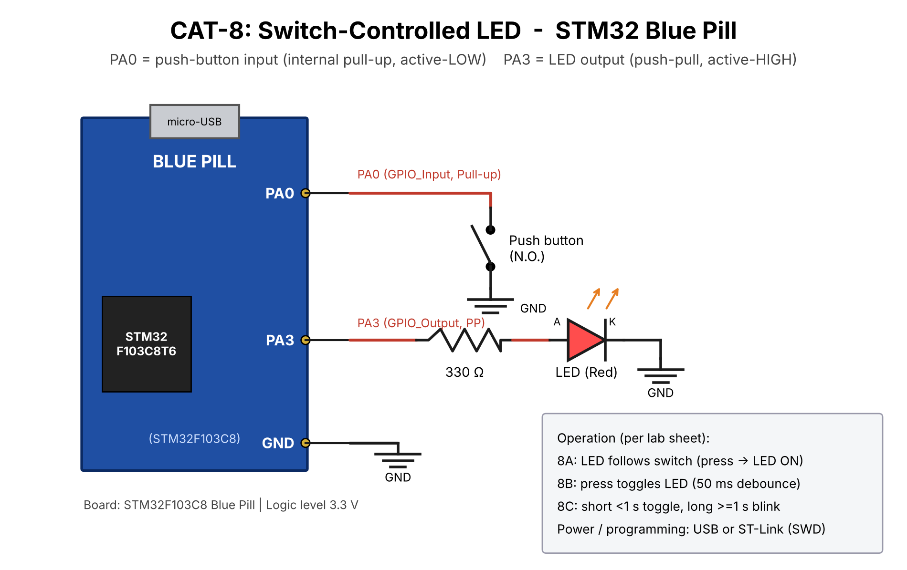

# TASK 8A – Switch-Controlled LED Using STM32

## 1. Aim
To interface a push button and an LED with the STM32F103C8T6 Blue Pill board using GPIO input and output operations.

## 2. Hardware Components
- STM32F103C8T6 (Blue Pill)
- Push Button (Normally Open)
- Red LED
- 330 Ω Resistor
- Jumper Wires

## 3. Circuit Connections

| STM32 Pin | Connection |
|---|---|
| PA0 | Push button input |
| PA3 | LED output |
| GND | Common Ground |

- PA0 is configured as an input with an internal pull-up resistor.
- PA3 is configured as a push-pull output.
- The LED is connected through a 330 Ω current-limiting resistor.

## Circuit diagram

## 4. Working Principle

The push button is connected to PA0 and operates in active-LOW mode.

- When the button is pressed, PA0 reads LOW and the LED turns ON.
- When the button is released, PA0 reads HIGH and the LED turns OFF.

The STM32 continuously monitors the button state and controls the LED accordingly using HAL GPIO functions.

## 5. Result

The push button successfully controls the LED through GPIO input and output operations on the STM32F103C8T6 board.
