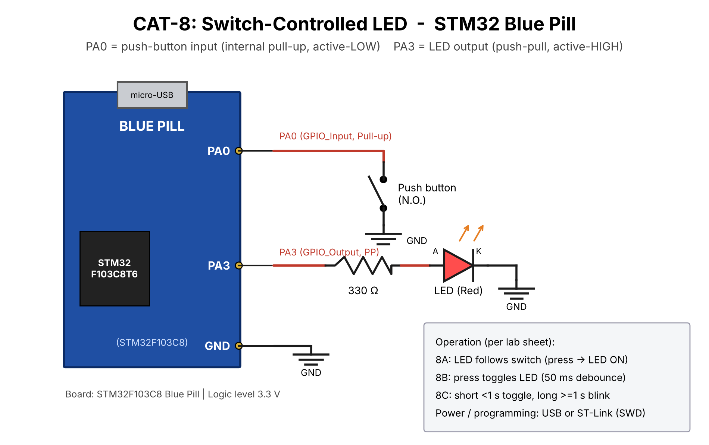

# TASK 8B – Push Button Controlled LED with Debouncing

## 1. Aim
To implement event-based LED control using a push button and STM32 GPIO, preventing unwanted multiple triggers caused by mechanical switch bouncing.

## 2. Hardware Components
- STM32F103C8T6 (Blue Pill)
- Push Button (Normally Open)
- Red LED
- 330 Ω Resistor
- Jumper Wires

## 3. Circuit Diagram

## 4. Pin Connections

| STM32 Pin | Connection |
|---|---|
| PA0 | Push Button Input |
| PA3 | LED Output |
| GND | Common Ground |

PA0 uses an internal pull-up resistor, while PA3 is configured as a push-pull output.

## 5. Working Principle

The program detects button presses and toggles the LED whenever a valid press is registered.

- The button state is continuously monitored.
- A 30 ms debounce delay filters out unwanted transitions.
- Once a stable press is detected, the LED changes its current state.
- Each valid press toggles the LED only once.

The implementation uses `HAL_GetTick()`, `HAL_GPIO_ReadPin()` and `HAL_GPIO_TogglePin()`.

## 6. Result

The LED successfully toggles with every button press. Software debouncing ensures reliable operation by eliminating unwanted multiple triggers.
