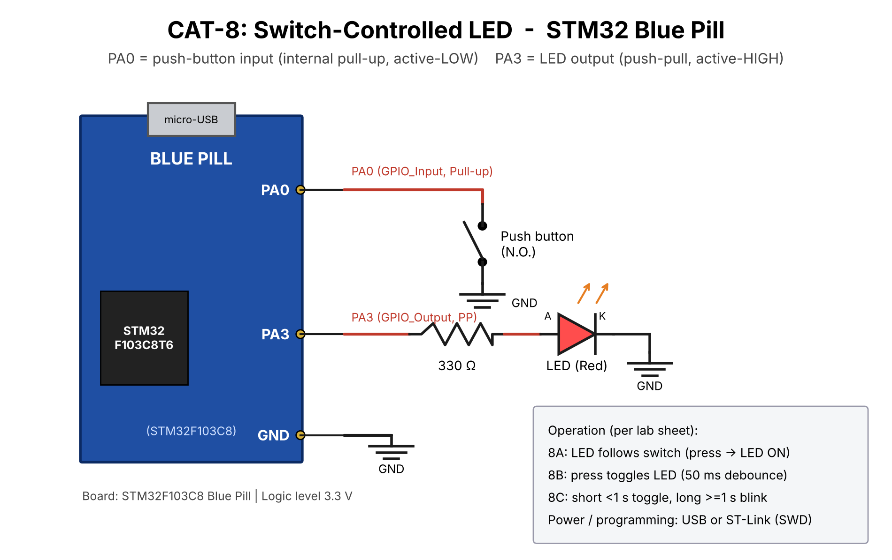

# TASK 8C – Short Press and Long Press LED Control

## 1. Aim
To implement short-press and long-press detection using an STM32 Blue Pill, controlling LED toggling and blinking based on button press duration.

## 2. Hardware Components
- STM32F103C8T6 (Blue Pill)
- Push Button (Normally Open)
- Red LED
- 330 Ω Resistor
- Jumper Wires

## 3. Circuit Diagram

## 4. Pin Connections

| STM32 Pin | Connection |
|---|---|
| PA0 | Push Button Input |
| PA3 | LED Output |
| GND | Common Ground |

PA0 is configured with an internal pull-up resistor, and PA3 is configured as a push-pull output.

## 5. Working Principle

The LED behaviour depends on how long the push button is pressed.

- **Short Press (< 1 second):** Toggles the LED.
- **Long Press (≥ 1 second):** Starts continuous LED blinking.
- **Short Press during blinking:** Stops blinking and turns the LED OFF.
- **Another Long Press:** Restarts blinking.

A 30 ms software debounce mechanism ensures reliable button detection. The LED blinking is implemented using `HAL_GetTick()` without blocking delays.

## 6. Result

The STM32 successfully distinguishes between short and long button presses and controls the LED accordingly.
