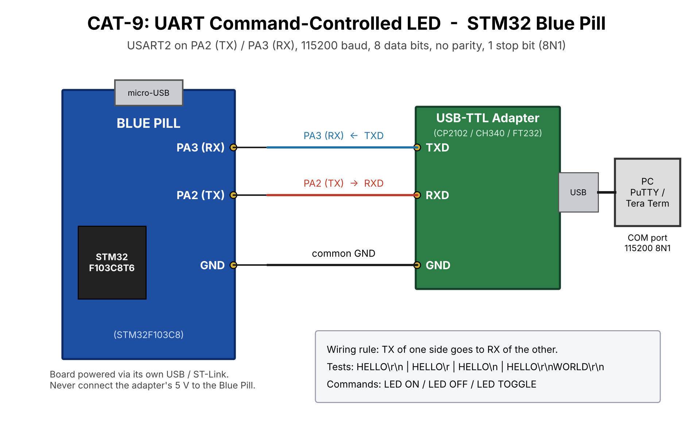

# Task 9A – Basic UART Communication

## Overview
This task demonstrates UART communication between the STM32F103C8T6 (Blue Pill) board and a PC using a USB-to-TTL converter.

The STM32 continuously transmits the character `A` at one-second intervals and echoes back any character received from the serial terminal.

## Configuration

- **Board:** STM32F103C8T6 (Blue Pill)
- **Peripheral:** USART2
- **Baud Rate:** 115200
- **Format:** 8-N-1
- **TX Pin:** PA2
- **RX Pin:** PA3

## Circuit Diagram

## Working

1. STM32 transmits `A` every second.
2. Characters entered in the PC terminal are received by STM32.
3. The received characters are transmitted back to the terminal (Echo).

## Software Used
- STM32CubeMX
- Keil MDK
- PuTTY / Tera Term
