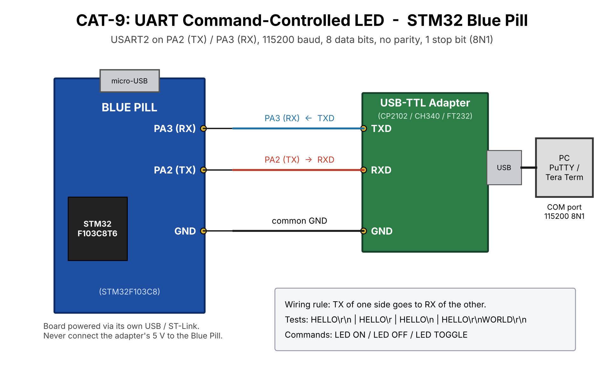

# Task 9B – UART-Based LED Control

## Overview
This task demonstrates controlling the onboard LED of the STM32F103C8T6 (Blue Pill) using commands received through UART communication.

## Configuration
- **Board:** STM32F103C8T6 (Blue Pill)
- **Peripheral:** USART2
- **Baud Rate:** 115200
- **Format:** 8-N-1
- **TX Pin:** PA2
- **RX Pin:** PA3
- **LED Pin:** PC13 (Onboard LED, Active-LOW)

## Circuit Diagram

## Supported Commands

| Command | Function |
|---|---|
| `LED ON` | Turns ON the LED |
| `LED OFF` | Turns OFF the LED |
| `LED TOGGLE` | Toggles the LED |
| `HELP` | Displays available commands |

Commands are entered through a serial terminal (PuTTY / Tera Term), and the STM32 processes them and sends back corresponding responses.

## Software Used
- STM32CubeMX
- Keil MDK
- PuTTY / Tera Term
